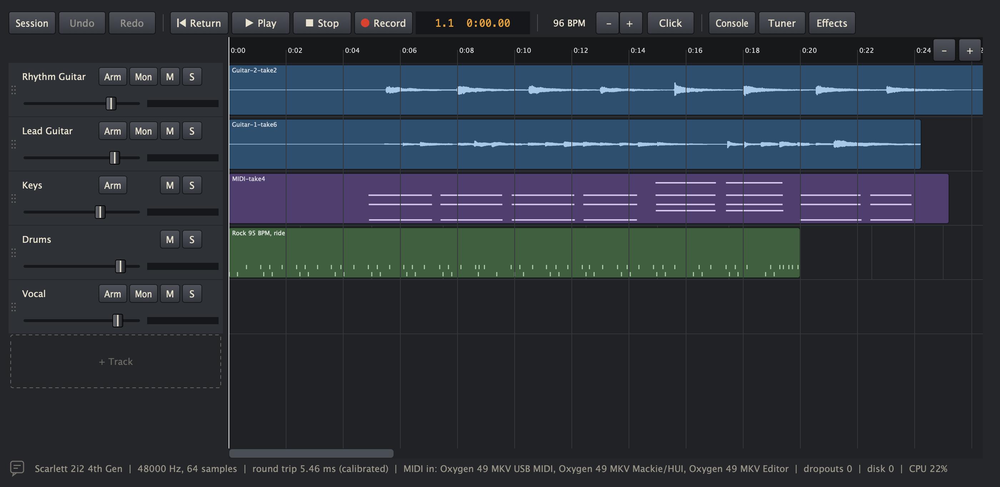
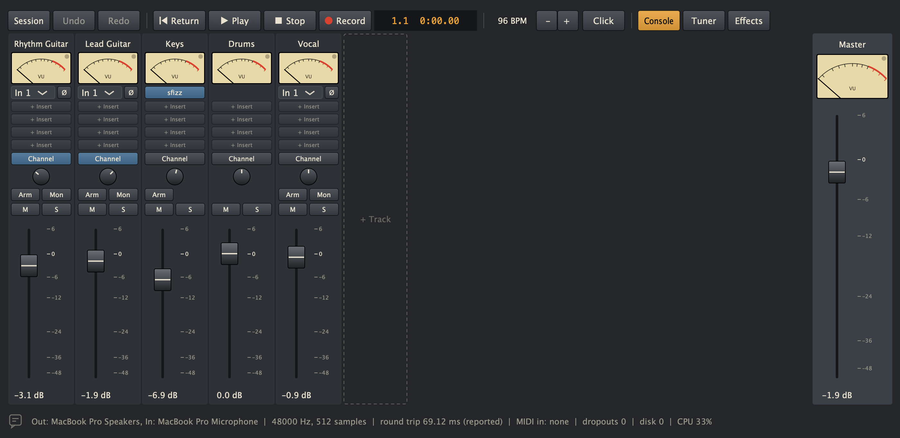
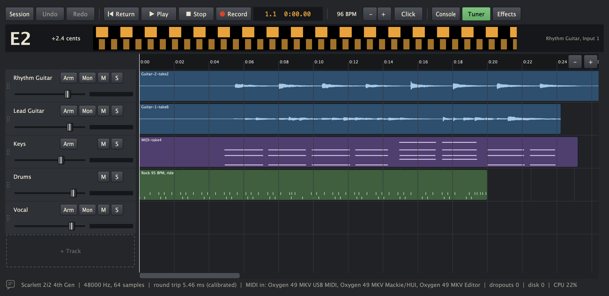
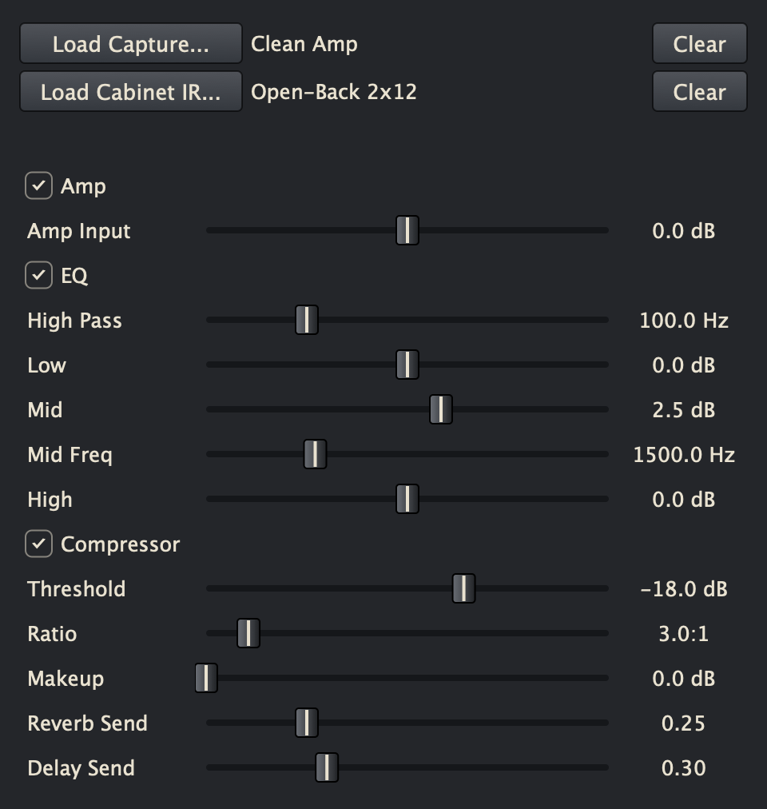

# RoughTrack

A simplified multitrack DAW for macOS. Record anything through your audio interface, play MIDI instruments from a keyboard, lay down drums from real drummers' grooves, mix on a console with amps and effects, and bounce a mixdown or stems. Start with one track and add more as you need them, up to 24.

**[Download RoughTrack for macOS](https://github.com/dantaipan/roughtrack/releases/latest)**: macOS 13 or later, Apple Silicon or Intel, signed and notarized.



## Build

Requires macOS 13+, Xcode, CMake and Ninja (`brew install cmake ninja`).

```sh
cmake --preset debug
cmake --build --preset debug
ctest --preset debug
```

The app is built to `build/debug/app/RoughTrack_artefacts/Debug/RoughTrack.app`. Builds are signed with your Apple Development certificate if you have one, and ad-hoc otherwise. Pass `-DROUGHTRACK_CODESIGN_IDENTITY=...` to choose another identity.

## Release

`tools/make_release.sh` builds a universal app (Apple Silicon and Intel), signs it with your Developer ID, has Apple notarize it, and wraps it in a signed and notarized disk image in `dist/`. It needs a Developer ID Application certificate and notarytool credentials saved once with `xcrun notarytool store-credentials roughtrack-notary --apple-id <email> --team-id <team>`.

## Updates

About once a day, starting a few seconds after launch, RoughTrack asks GitHub whether a newer release is out. If one is, it shows that release's notes with **Download**, which opens the disk image in your browser, **Skip This Version** and **Later**. **RoughTrack → Check for Updates...** checks straight away, and **Settings → Check for Updates Automatically** turns the daily check off. The only thing sent is an ordinary request for the latest release.

## Sessions

Each session is a folder in `~/Music/RoughTrack`, holding its takes, `session.xml` and `inserts.xml`. It saves automatically, and the folder can be moved.

A session keeps the sample rate its first audio take was recorded at, and when it opens, RoughTrack sets the interface to that rate. Another app, such as GarageBand, can hold the interface at a different rate. Then the status line says so in amber, because takes would play at the wrong speed and pitch, and recording audio and mixing down wait until the rates match. MIDI and drums follow the tempo, so a session without audio takes runs at any rate.

Editing never changes a recording. Takes are always dry, and clips only say which part of a take plays and when. A new recording plays over what's already there, so punching in replaces only the part it covers. Press **Record** during playback to punch in at that moment, and **Stop** to end the take.

A new session starts with one audio track. The dashed **+ Track** after the last track, in the timeline or the console, adds more, up to 24: **Audio** for anything through your interface, **MIDI** or **Drums**. Drag a track up or down by its name to reorder it, and the console follows. Double-click a track's name to rename it, and right-click it to delete the track. Deleting a track leaves its recordings in the session folder.

Audio settings and latency calibration are in the **Settings** menu in the menu bar. Command-comma opens Audio Settings. **RoughTrack → About RoughTrack** shows the version and the credits for the drums, grooves and libraries. Messages show in the status line for a few seconds, then wait behind the speech-bubble icon beside it. Its number counts the ones you haven't seen, and it turns amber for a warning, such as a take with audio gaps. Click it to read them all.

On the timeline, drag a clip to move it and drag its edges to trim it. Moves, trims and splits snap to the grid chosen with **Snap** in the toolbar (Bar, Beat, 1/16 or Off), and the session remembers the choice. Hold Command while dragging to place freely. The ruler shows bar numbers under the minutes and seconds, and bar lines run through every lane. Trimming both ends of a take to bar lines makes it a whole number of bars, so it loops in time. Right-click a clip or drum part and choose **Loop Until Next Part** to have it repeat until the next one on its track starts, or to the end of the song if nothing follows. A looping part shows a circular arrow by its name, and its repeats are drawn dimmed, each marked where it starts over. Dragging a loop's end stops it looping and keeps the repeats up to where you let go. To fade an audio clip in or out, point at it and drag the small square in its top-left or top-right corner inward; the fade is drawn as a curve over the waveform, and a looping clip fades in once at its start and out once at the end of its last repeat. Right-click for Split Here, Delete Clip, and Add Take at Playhead, which brings back any take in the session folder. Command-Z undoes, Shift-Command-Z redoes, Space plays and stops, and Delete removes the selected clip.

To play a stretch over and over, drag along the bar numbers in the ruler. The range snaps to the grid and shows as an orange band, and playback goes round it until you stop. Drag the band's edges to adjust it, or its middle to move it. **Loop** in the toolbar, or L, turns it off and on, and the session remembers it. Playing from before the range leads into it. Playing from after it starts at the beginning of the range. Recording plays straight through the loop. Clicking the bar numbers, or the time above them, still moves the playhead. To take the loop off the timeline altogether, right-click the ruler and choose **Clear Loop**.

## Mixdown

**Session → Mix Down to WAV...** mixes the whole session into a 24-bit stereo WAV at the session's sample rate, saved in the session's `Mixdowns` folder unless you choose somewhere else. It renders faster than real time through the same mixer you hear, and runs on until any reverb or delay tail has died away. Live inputs, the keyboard and the click are left out. If the mix goes over full scale, RoughTrack says by how much to lower the master fader.

**Session → Export Stems...** writes one WAV per track you can hear, numbered in track order, plus one for the reverb and delay returns, into a new folder in `Mixdowns`. They all start at the beginning of the session and run the same length, and they include the master fader, so dropped into another DAW at the same point they add up to the mix. Muted tracks are left out, as they are from the mix. Some instruments, including the macOS synth, never play exactly the same way twice, so a stem of one can differ very slightly from a separate mixdown.

## Console

**Console** (or the X key) opens a full mixing desk under the timeline: every track as a channel with its input, polarity, plugins, pan, Arm, Mon, mute, solo, fader and VU meter, plus the master fader. The timeline stays in view, so you can watch the song while you mix. Drag the bar between them to share the space, and RoughTrack remembers the size. A track's row and its channel control the same track, so a change in one shows in the other.

**Pop Out** moves the console into its own window, for a second screen or a bigger mixer. Closing that window hides the console, and Console or X brings it back where you left it. **Dock** puts it back under the timeline. Space, X and the other shortcuts work from either window.



An armed track's meter shows what's arriving at its input, whether or not Mon is on, because that's what gets recorded. Set your level on the interface so the needle sits around 0, which is a sine peaking at -18 dBFS. The light on a meter means a level near full scale, and it stays on until you click it. **Ø** flips a track's polarity in the mixer and leaves the take as recorded.

**Tuner** opens a strobe tuner across the top of the window. It reads the input of the first armed audio track, or of the first audio track if none is armed. The bands drift right when a string is sharp, left when it's flat, and stand still in tune. Play one string at a time: a chord has no single pitch, and an open E chord reads as E1.



## Amps and effects

Each track's **Channel** button opens its amp, cabinet, EQ, compressor and sends. The signal runs amp and cabinet, plugin inserts, EQ, compressor, fader, then the sends. To put a plugin in front of the amp, like a pedal, right-click its insert and choose **Before Amp**; the slot turns amber. Plugins before the amp run in slot order too, so an overdrive in slot 1 and a reverb in slot 2 can sit either side of the amp. **Effects** holds the reverb and delay that every track shares. None of this adds latency, and takes always stay dry, so any of it can change after recording.



RoughTrack doesn't ship amp captures. Load your own `.nam` files, including A2, and any `.wav` or `.aiff` cabinet IR. Sessions remember captures and IRs by their full path, so moving those files leaves a session reporting them as missing.

CPU depends on the capture. On an M4 at 48 kHz, a standard capture takes about 5% of a core and an A2 capture about 3%, while the largest (32-channel) captures take about 19%, which limits a session to two or three of them at any buffer size. The status bar shows CPU live and turns amber above 80%.

## Checking real hardware

`roughtrack_bench` runs the checks that need a real device. It's built to `build/<preset>/tools/`.

```sh
roughtrack_bench soak 1800 --device "Scarlett 2i2 4th Gen" --buffer 64 --record
roughtrack_bench overdub-check --device "Scarlett 2i2 4th Gen" --buffer 64
roughtrack_bench scan-plugins
roughtrack_bench plugin-check --buffer 64 --name TONEX
roughtrack_bench plugin-window VST3 NeuralAmpModeler
roughtrack_bench amp-check capture.nam --instances 4
roughtrack_bench soak 60 --amp capture.nam --cabinet cabinet.wav --full-channel
roughtrack_bench tuner-check take.wav
roughtrack_bench midi-check --instrument sfizz --state inserts.xml
```

`overdub-check` plays test sweeps, so turn your monitors down and connect output 1 to input 1 with a cable first.

`scan-plugins` lists every installed VST3 and Audio Unit, each loaded in its own process. `plugin-check` runs third-party effects through the engine with no device. It loads them with default settings, so its timings don't show the cost of a loaded amp model. `plugin-window` opens an editor the way the app does and prints its native views. `midi-check` plays a connected keyboard through an instrument and prints the levels it reaches.

`RoughTrack --snapshot <session folder> <png file> [track] [console] [console-window] [timeline] [tuner] [2x]` renders the real window on a session and quits, so the layout can be checked without anyone at the screen. With a track number it renders that track's channel window instead, `console-window` renders the console in its own window, and `2x` saves at Retina resolution. Snapshots don't change the view RoughTrack remembers. The pictures in `docs/screenshots` were made this way.

## Drums

Choose **Drums** under **+ Track**, then right-click its lane and use **Add Groove Here**. Rest the pointer on a groove in the menu to hear it: a ring fills beside its name, and after a moment it plays at the session's tempo through that track. While the song plays, it plays in time, in place of the track's own parts, until you move on or close the menu. Grooves are real drummers' performances played through a sampled kit, so they follow the session tempo without any time-stretching. They're counted in bars: drag a part to move it, or drag its right edge past the end of the groove to loop it. **Add Fill Here** drops a fill over the bars it covers, replacing the groove underneath. The BPM on each groove and fill is the tempo the drummer played it at. Everything plays at the session tempo, and the menus list what was recorded within 5% of it first, because that sounds most natural. Parts are saved with the session and undo like clips. Changing the tempo moves parts in time, and recorded audio stays where it is, so set the tempo first.

`resources/drums` is generated. `tools/build_grooves.py` cuts `grooves.xml` from the Groove MIDI Dataset, and `roughtrack_bench build-kit` mixes DRSKit to stereo. See [CREDITS](resources/drums/CREDITS.md).

## MIDI

Choose **MIDI** under **+ Track**. A new track starts on the General MIDI synth built into macOS; click its instrument button to pick any AU or VST3 instrument, or to open its window. Every connected keyboard is used, and the status bar lists them. Arm the track to play it, and press Record to capture a take. Takes are standard `.mid` files in the session folder, and clips move, trim, split and undo like audio, snapping to sixteenth notes. Like drums, they follow the tempo.

Right-click a MIDI clip and choose **Quantize** to tighten it to quarters, eighths, sixteenths or triplets. This writes a new take beside the original, so the performance as played is never changed. Undo goes straight back, and the original stays under **Add Take at Playhead**.

### Transport buttons on a keyboard

A keyboard's play, stop, record, rewind, fast-forward and track buttons can run RoughTrack, as they do other DAWs. There are two common ways keyboards send them, and RoughTrack understands both:

- **Mackie Control.** Many keyboards have a DAW mode that acts as a Mackie Control surface on a second MIDI port. Choose the keyboard's **Mackie** mode, not one made for a particular DAW such as Ableton, HUI or InControl. For example, on an M-Audio Oxygen MKV, hold **DAW/Preset** and choose **NC1**. RoughTrack picks the port by itself when its name includes "Mackie", "DAW" or "MIDIIN2". If yours is named differently, choose it under **Settings → Controller**. Nothing from that port is played as notes, so the keyboard's keys keep playing through its main port.
- **MMC (MIDI Machine Control).** Keyboards that send MMC from their transport buttons work from any port, with nothing to set up.

| Button | What it does |
|---|---|
| Play | Plays. |
| Stop | Stops. Pressed while stopped, it goes back to the start. |
| Record | Records, the same as the Record button. |
| Rewind / Fast-forward | Moves back or on by a bar, while stopped. |
| Loop (Cycle) | Mackie only. Turns the loop off and on. |
| Track or Bank ◀ ▶ | Mackie only. Moves the record arm to the track above or below. |

The buttons under a Mackie keyboard's faders work on the eight tracks around the armed one: tracks 1 to 8, 9 to 16 or 17 to 24. The keyboard chooses what they do. In its record mode they arm tracks, in solo and mute modes they solo and mute, and in select mode they arm just that track.

When the keyboard listens, its button lights follow RoughTrack. Keyboards that only send plain controller messages from these buttons aren't supported yet.

The status line names the controller port in use.

## Layout

- `engine/`: audio engine library, with no UI code
- `app/`: the macOS application
- `tests/`: Catch2 tests for the engine
- `tools/`: `roughtrack_bench`, for checks on real hardware, and the release script
- `resources/`: the drum kit, grooves and app icon

## Credits

- [JUCE](https://juce.com), under AGPLv3
- [NeuralAmpModelerCore](https://github.com/sdatkinson/NeuralAmpModelerCore), MIT, with [Eigen](https://eigen.tuxfamily.org) (MPL 2.0) and [nlohmann/json](https://github.com/nlohmann/json) (MIT)
- [Catch2](https://github.com/catchorg/Catch2), BSL 1.0, for tests
- DRSKit by Lars Muldjord and Bent Bisballe Nyeng, CC BY 4.0. Drum samples provided by [DrumGizmo.org](https://www.drumgizmo.org)
- [Groove MIDI Dataset](https://magenta.withgoogle.com/datasets/groove) by Gillick, Roberts, Rob and Bansal, CC BY 4.0

## License

AGPL-3.0-or-later. See [LICENSE](LICENSE). RoughTrack uses [JUCE](https://juce.com) under its AGPLv3 option.
